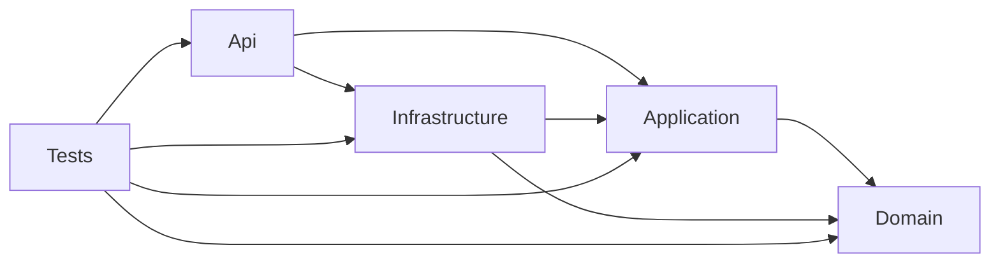

# 1. CQRS basics and project structure

**CQRS** = separate the code that *changes* state (commands) from the code that *reads* state (queries). Here both use the same SQL Server database and the same `CatalogDbContext`; only the code paths and models differ.

| Side | Model | Example |
|---|---|---|
| Write | Domain entity `Product` with rules | `CreateProductHandler`, `UpdateProductHandler`, `AdjustProductStockHandler`, `DeleteProductHandler` |
| Read | Projected DTOs, `AsNoTracking` | `GetProductsHandler` → `ProductSummaryDto`, `GetProductByIdHandler` → `ProductDetailsDto` |

## Projects and dependency direction

- **Domain** – `Product` entity and rules (non-empty name, price >= 0, stock >= 0). No dependencies.
- **Application** – commands/queries, handlers, DTOs, `IReadDbContext` / `IWriteDbContext`. Knows nothing about SQL Server.
- **Infrastructure** – `CatalogDbContext` (implements both interfaces), `ProductConfiguration`, migrations, `SampleDataSeeder`, `DependencyInjection.cs`.
- **Api** – `Program.cs` registers handlers; `Endpoints/ProductEndpoints.cs` receives them by direct injection; `ErrorHandling/ProblemDetailsExceptionHandler.cs` maps exceptions to status codes.
- **Tests** – unit tests (no DB) and SQL Server integration tests.

No circular references; Domain is the innermost layer.
