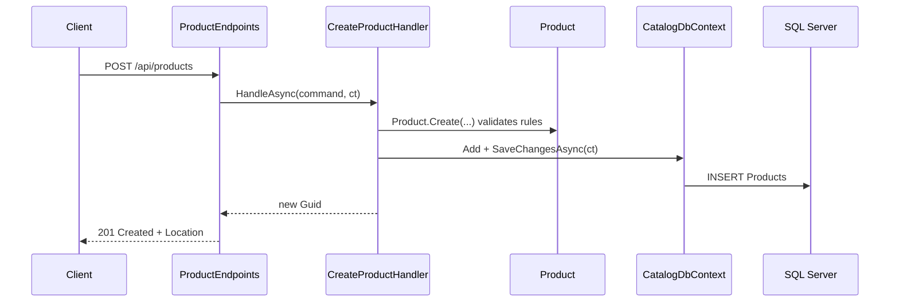

# 2. Create-product command walkthrough

`POST /api/products` with `{ "name": "Widget", "price": 19.99, "stockQuantity": 5 }`

1. `ProductEndpoints.CreateProduct` (src/CqrsDemo.Api/Endpoints/ProductEndpoints.cs) builds a `CreateProductCommand` and calls the injected handler.
2. `CreateProductHandler.HandleAsync` (src/CqrsDemo.Application/Products/Commands/CreateProduct/CreateProductHandler.cs) calls `Product.Create` in `Domain/Products/Product.cs`, which throws `DomainValidationException` for a blank name or negative price/stock.
3. The entity is added and `SaveChangesAsync(cancellationToken)` inserts it; SQL CHECK constraints in `ProductConfiguration.cs` are a second line of defence.
4. The endpoint returns `CreatedAtRoute("GetProductById", ...)`: status 201, a `Location` header, body `{ "id": ... }`.
5. Invalid input: the exception handler turns `DomainValidationException` into a 400 Problem Details with per-field errors.
