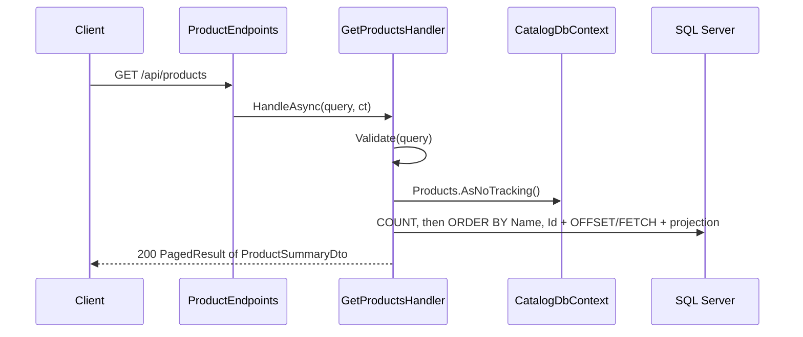

# 3. Get-products query walkthrough

`GET /api/products?name=mouse&page=1&pageSize=2`

1. `ProductEndpoints.GetProducts` maps `page`, `pageSize`, `name` to `GetProductsQuery`.
2. `GetProductsHandler.HandleAsync` (src/CqrsDemo.Application/Products/Queries/GetProducts/GetProductsHandler.cs) runs `Validate`: page >= 1 and pageSize within the allowed bound; otherwise `RequestValidationException` → 400.
3. The query starts from `AsNoTracking()` (reads never enter the change tracker), applies the optional name filter (wildcards are escaped and matched literally), counts, then orders by `Name` then `Id` so paging is deterministic.
4. `Skip/Take` and `Select(... new ProductSummaryDto ...)` fetch only the columns needed; no entity is materialised.
5. Reads never call `SaveChangesAsync`; an integration test snapshots the rowversion before/after to prove data is unchanged.
